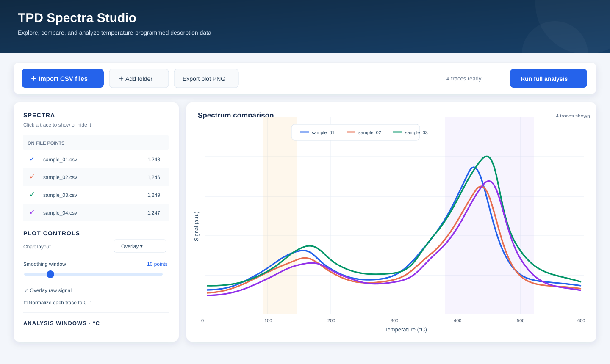

<div align="center">

# TPD Spectra Studio

**A friendly desktop workspace for comparing and analyzing temperature-programmed desorption spectra.**

[](https://github.com/karol-cieslik/TPD-Spectra-Analysis/actions/workflows/desktop-build.yml)
[](https://www.python.org/)
[](LICENSE)
[](https://github.com/karol-cieslik/TPD-Spectra-Analysis/actions)

<br />



</div>

Import several CSV files, compare their desorption traces, tune smoothing and analysis windows, then save publication-ready plots and a full results bundle. The desktop app is designed for interactive review; the same analysis engine is also available from the command line and Python.

## Get the Windows desktop app

Open the [latest successful Windows desktop build](https://github.com/karol-cieslik/TPD-Spectra-Analysis/actions/workflows/desktop-build.yml), select the newest completed run, and download **tpd-spectra-windows-x64** from its Artifacts section. Unzip the package, then double-click **tpd-spectra-gui.exe**. Keep `tpd-spectra.exe` in the same folder for the Run full analysis button.

The desktop build is generated by GitHub Actions from this repository. The standalone app does not require a separate Python installation. On first launch, Windows may ask whether to run an app downloaded from the internet; verify that you downloaded the build from this repository before opening it.

## What you can do

- **Import multiple spectra** at once, or load every CSV in a folder. Add or remove files and toggle individual traces in the comparison.
- **Compare traces** as a color-coded overlay or in small multiples. Switch the horizontal axis between temperature and time, and optionally normalize traces to compare peak shapes.
- **Tune the view interactively** with median, mean, or no smoothing; adjust the smoothing window and drag the leading-edge and peak-search temperature ranges.
- **Export the current plot** as a high-resolution PNG, or run the complete batch analysis to create CSV result tables and per-spectrum diagnostic plots.
- **Explore kinetic fits** with optional single-state, two-state, or comparison fits and visible reaction-order and baseline settings.
- **Keep a reproducible record**: batch results include the effective settings, input file identities, warnings, and fit diagnostics.

## Quick start with Python

Python 3.10 or newer is recommended.

```bash
git clone https://github.com/karol-cieslik/TPD-Spectra-Analysis.git
cd TPD-Spectra-Analysis
python -m venv .venv
```

Activate the environment, then install and launch:

```powershell
# Windows PowerShell
.venv\Scripts\Activate.ps1
python -m pip install -r requirements.txt
python run_tpd_spectra_gui.py
```

```bash
# macOS / Linux
source .venv/bin/activate
python -m pip install -r requirements.txt
python run_tpd_spectra_gui.py
```

The command-line version can analyze one file or a folder:

```bash
python -m pip install -e .
python -m tpd_spectra /path/to/csv-folder --output results
```

Add `--kinetic-fit --kinetic-order 1` to request a single-state kinetic fit. Use `python -m tpd_spectra --help` to see all options.

## Input and output

The importer recognizes the legacy instrument columns `ms`, `DHTA+`, and `Temperatura`, as well as common English alternatives for time, signal, and temperature. It handles the legacy 29-row metadata header and standard header-row CSVs; the legacy default is semicolon-delimited with decimal commas. The app expects measurement data in CSV files. Bring your own spectra: experimental datasets are not included in this public repository.

Full analysis writes:

| File | Contents |
| --- | --- |
| `all_desorption_parameters.csv` | Per-spectrum classical estimates and diagnostics |
| `batch_summary.csv` | Combined results, including numerical fits when requested |
| `all_tds_spectra.png` | Overlay of the analyzed traces |
| `diagnostics/` | Per-spectrum plots showing signal, selected intervals, and fit residuals |
| `analysis_warnings.csv` / `analysis_errors.csv` | Review prompts and file-level failures when present |
| `analysis_project.json` | Settings, software version, input names, file sizes, and SHA-256 hashes |

The app's **Export plot PNG** button saves the currently visible comparison, including its layout and display settings, at 300 dpi.

## Scientific scope

Reported energies are model-dependent apparent estimates. Leading-edge analysis assumes signal is proportional to desorption rate over the selected interval. The Redhead estimate uses a first-order model and an assumed prefactor. Kinetic fits use the selected Polanyi–Wigner model and heating-ramp assumptions; two-state fits are exploratory. A successful fit or a high R² does not prove a unique mechanism. Inspect the traces, fit intervals, residuals, warnings, calibration, and experimental context before interpreting results.

## Development

```bash
python -m pip install -r requirements-build.txt
python -m pytest -q
```

The Windows build workflow packages the standalone CLI and desktop GUI in one ZIP. The project-authored code is under the MIT License. Experimental spectra, the historical notebook, and other omitted materials may have separate rights; see [ASSET-RIGHTS.md](ASSET-RIGHTS.md).

## Citation

Citation metadata is in [CITATION.cff](CITATION.cff). For questions or bug reports, open a [GitHub issue](https://github.com/karol-cieslik/TPD-Spectra-Analysis/issues).
