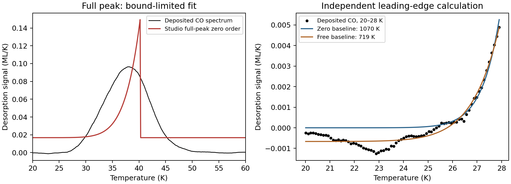

# Deposited pure-ice energy comparison: Ar and CO

## Sources and scope

Kruczkiewicz, Dulieu, Ivlev, Caselli, Giuliano, Ceccarelli and Theulé (2024),
*Comprehensive laboratory constraints on thermal desorption of interstellar ice
analogues*, A&A 686, A236, https://doi.org/10.1051/0004-6361/202346948 .
Franciele Kruczkiewicz's deposited data: https://doi.org/10.5281/zenodo.10912815
(version v1, CC-BY-4.0, https://creativecommons.org/licenses/by/4.0/).
Credit the original authors when reusing their data. These derived analyses were
performed for Studio's assessment; no author endorsement is implied.

The archive MD5 matches the repository checksum. The two original CSV members
are retained unchanged inside deterministic gzip files, with individual SHA-256
hashes and original archive README. They explicitly identify temperature in K
and desorption signal in ML/K; no plot digitization was needed. The measured
time channel is not supplied. The paper supplies beta = 0.2 K/s, but measured
ramp linearity cannot be checked from temperature-versus-signal data alone.
The chemical header identifies Ar; its filename prefix 4 differs from Table 2's
experiment 3. No identity inference is made from the filename number alone.

The final published article (Table 3 and section 4.2.1, printed p. 8) reports
zero-order leading-edge estimates of 933 ± 96 K for Ar and 1040 ± 104 K for CO,
with upper temperature cutoffs 27 and 28 K. The complete baseline and lower
window choices are not specified sufficiently for an exact replication. The
paper's leading-edge energy and Studio's ideal full-peak depletion profile use
different portions of the observations; comparing them is a model challenge,
not an assumption that every measured peak should have an abrupt cutoff.

## Frozen assessment and results

`protocol.json` was saved before the first fit. It preserves primary 20–60 K
and sensitivity 22–55 K windows, both zero and free constant baseline choices,
and original samples. No sorting, smoothing or repairs are applied. Both
materials are retained regardless of agreement. No prefactor comparison is
made: the normalized-population model with free signal scale does not determine
a unique physical multilayer prefactor.

Ar's primary and leading-edge intervals fail the strict increasing-temperature
screen (small reversals and duplicate readings). Those intervals were withheld;
the independently prespecified 22–55 K window passes. All six completed Studio
full-peak fits hit the lower energy bound 0.05 eV (580.23 K). Their NRMSE values
are 0.2191–0.3243, dividing signal RMSE by the selected signal range. These
results do **not** reproduce the published energies and must not be accepted
just because optimization terminates. No bounds were relaxed to chase a match.

A separate nonlinear leading-edge calculation on CO at 20–28 K gives 1069.87 K
with baseline fixed to zero, within the published 1040 ± 104 K band; allowing
a constant baseline gives 718.74 K. This is substantial analysis sensitivity,
not an independent confirmation of the software's full-peak result. The quoted
published uncertainty band is used descriptively, not as a significance test.

An additional diagnostic was declared **after** these outcomes, in
`log_diagnostic_protocol.json`: the application's existing log-signal leading
edge on the same CO interval gives 1336.50 K, retaining only 26 of 78 points
because its mask excludes nonpositive signal. Independent NumPy OLS agrees
within 1e-9 K, verifying numerical agreement for this regression, not physical
accuracy. Positive-noise selection, baseline structure and different residual
weighting limit comparison with nonlinear fitting. No interval was tuned to
produce agreement. This diagnostic is separate from the pre-fit protocol.



## Reproduce and next decision

From the repository root:

```sh
python scripts/experimental_ice_check.py
python scripts/plot_ice_comparison.py
python scripts/experimental_ice_log_check.py
```

The first command regenerates full-peak and nonlinear leading-edge records and
primary full-peak predictions; the second plots retained records without fitting.
The third command regenerates the separately declared application/NumPy regression diagnostic.
`summary.json` and `provenance.json` record interpretation and source checks.

This completes acquisition of an accessible, explicitly identified experimental
energy reference and a reproducible comparison. It does not complete a positive
experimental accuracy-validation gate. Neither instrument-response effects nor
the physical origin of these broad measured tails was established here. Further
scientific explanation requires independent review; do not label the mismatch
an optimizer defect or repair the program merely to match the literature value.
The immediate publication task is to audit manuscript claims against these
limits. General experimental energy accuracy must remain unclaimed.

## Directly inspectable original CSV files

The same unchanged source bytes are also available as
[Ar CSV](raw/4_Ar_pure.csv) and [CO CSV](raw/2_CO_pure.csv), in addition to the
retained gzip originals. Their SHA-256 hashes match `provenance.json`. Git is
configured to preserve their original line endings. They use semicolons and
include source units in comment headers. For diagnosis and the next planned
studies, see [findings and follow-up](../FINDINGS_AND_NEXT_STUDIES.md).
